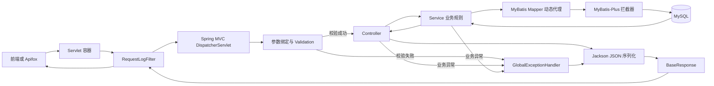
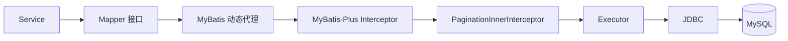
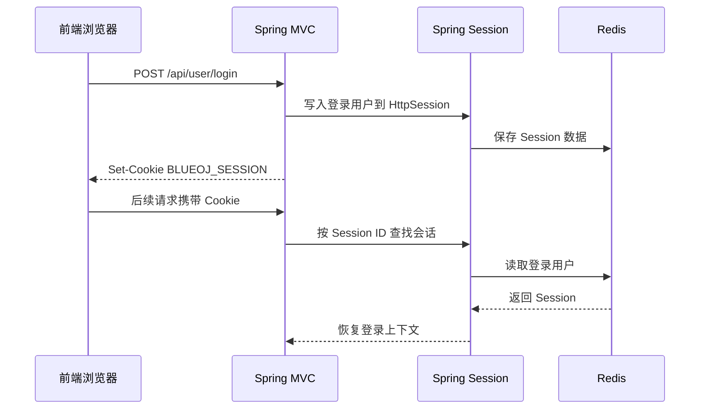
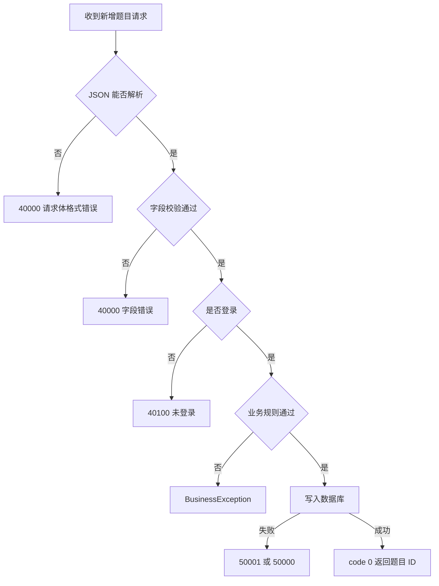
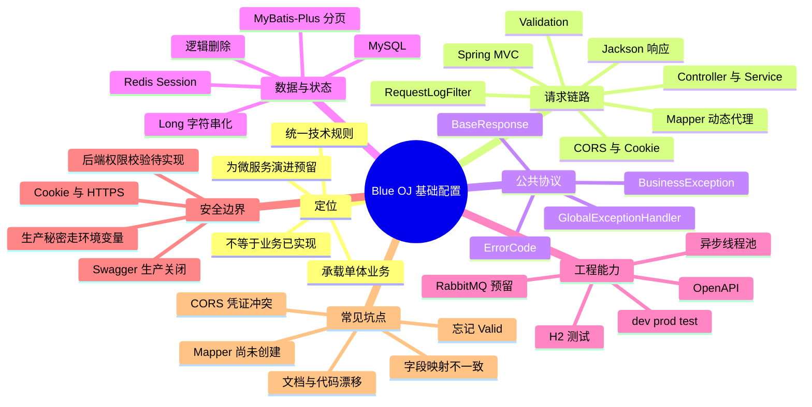

# Blue OJ 后端基础配置学习与实战指南

本文档记录 `E:\blue-oj-backend` 当前已经完成的后端基础配置，面向具备 Java 基础、正在系统学习 Spring Boot 后端开发的读者。版本基线是 **Java 17、Spring Boot 4.2.0、MyBatis-Plus 3.5.18、springdoc-openapi 3.2.1**，贯穿场景是“一个请求进入 Blue OJ 单体后端后，如何被追踪、校验、执行业务、访问数据库，并以统一 JSON 返回”。

这不是业务代码说明书，也不是让 LLM 直接继续写代码的指令。将本文交给其他 GPT/LLM 时，应要求它先讲清楚每一项配置解决的问题、运行时调用链和边界，再进入用户、题目、提交与判题业务。

## 1. 核心概念与定位

### 1.1 一句话定义

Blue OJ 的基础配置层是一组**横切整个后端项目的公共规则和基础设施适配**：它统一依赖版本、运行环境、响应格式、异常出口、参数校验、会话存储、跨域、JSON 序列化、数据库访问、接口文档、异步执行和请求日志。

它不直接回答“用户如何注册”“题目如何保存”“代码如何判题”，而是为这些业务提供一致、可复用的运行底座。

### 1.2 当前基础配置解决了哪些痛点

如果每个业务接口各自处理公共问题，项目会快速出现以下混乱：

- Controller 各自拼接不同的 JSON 响应，前端无法统一判断成功或失败。
- 每个接口重复 `try-catch`，异常信息和日志规则不一致。
- 参数错误、未登录、无权限、数据不存在混用同一个错误码。
- Java `Long` 返回前端后超过 JavaScript 安全整数范围，ID 被悄悄改值。
- 前端携带 Cookie 跨域请求时被浏览器拦截。
- 分页查询没有统一上限，容易被大分页拖垮数据库。
- 开发、测试、生产共用一份密码和地址，配置难以迁移且容易泄密。
- 日志无法判断同一条请求从哪里进入、耗时多少、在哪一步失败。
- 接口实现后没有 OpenAPI 文档，Apifox 和前端代码生成难以对齐。

当前配置把这些问题提前收敛，使后续业务代码只关注业务规则。

### 1.3 已经具备的能力

| 能力 | 当前落地点 | 作用 |
|---|---|---|
| 依赖与版本管理 | `pom.xml` | 统一 Spring Boot、MyBatis-Plus、OpenAPI 等依赖 |
| 多环境配置 | `application.yml`、`application-dev.yml`、`application-prod.yml`、`application-test.yml` | 隔离开发、生产和测试参数 |
| 统一响应 | `BaseResponse`、`ResultUtils` | 固定 `code / data / message` 契约 |
| 统一业务错误码 | `ErrorCode` | 让前后端基于稳定业务码协作 |
| 业务异常 | `BusinessException`、`ThrowUtils` | 在业务层主动中止错误流程 |
| 全局异常处理 | `GlobalExceptionHandler` | 将异常统一转换为响应对象 |
| 参数校验 | Validation Starter、`@Valid` 支持、通用请求类 | 在业务执行前阻止非法输入 |
| 跨域 | `CorsConfig`、`CorsProperties` | 允许指定前端地址携带 Cookie 调用后端 |
| JSON 大整数保护 | `JsonConfig` | 把 Java `Long` 输出为 JSON 字符串 |
| 数据库增强 | `MyBatisPlusConfig` | Mapper 扫描、分页插件和分页上限 |
| 逻辑删除规则 | `application.yml` | 约定 `isDelete=0/1` 的删除语义 |
| Session 共享基础 | Spring Session Redis | 将会话设计为可存入 Redis |
| 接口文档 | springdoc + `OpenApiConfig` | 暴露 OpenAPI JSON 和 Swagger UI |
| 请求追踪 | `RequestLogFilter` | 为每次请求生成 traceId 并记录耗时 |
| 异步基础 | `AsyncConfig` + 线程池参数 | 支持后续使用 `@Async` 执行本地异步任务 |
| 测试隔离 | H2 + test Profile + MockMvc | 不依赖开发 MySQL 完成基础上下文测试 |

### 1.4 尚未实现的能力

理解边界非常重要。当前基础配置完成，不等于以下业务已经完成：

- 没有 `user`、`question`、`question_submit` 数据表和初始化 SQL。
- 没有 Entity、DTO、VO、Mapper、Service、Controller 业务层。
- 没有注册、登录、注销、权限判断的实际代码。
- 没有 Spring Security，也没有自定义鉴权切面或拦截器。
- Redis Session 依赖已经存在，但只有业务代码创建 Session 后才会产生实际会话数据。
- RabbitMQ 依赖和连接参数已经准备，但没有交换机、队列、绑定、生产者或消费者。
- AOP 依赖已经准备，但没有实现权限注解或权限切面。
- `@EnableAsync` 已启用，但当前没有任何 `@Async` 业务方法。
- 没有判题服务、代码沙箱、Docker 调用或 MQ 异步判题流程。

> 核心判断：基础设施“可用”只代表框架具备承载能力，不代表业务链路已经存在。

### 1.5 使用场景与边界

**适用场景：**

- 多个 Controller 需要共享同一种响应和错误格式。
- 前后端分离，且登录态通过 Cookie + Session 维持。
- 项目需要从单体逐渐演进到 Redis Session、MQ 和微服务。
- 业务 ID 使用数据库 `BIGINT`，前端是 JavaScript/TypeScript。
- 开发、生产和自动化测试需要不同外部资源。

**不适用或需要调整的场景：**

- 纯服务端渲染且前后端同源时，CORS 可能不需要。
- 完全无状态的 JWT 服务不一定需要 Spring Session Redis。
- 只有单机、低流量、无异步任务的小工具，不必提前引入 RabbitMQ。
- 若团队采用标准 HTTP 状态码表达错误，目前“业务码为主”的异常响应方式需要继续调整。

**可能构成过度设计的地方：**

- 在还没有判题异步化之前就编写复杂 MQ 重试、死信和幂等框架。
- 在只有一个服务时立即引入网关、注册中心和分布式链路追踪。
- 为每个简单请求都创建独立线程，反而增加线程切换和上下文传递成本。

### 1.6 容易混淆的技术定位

| 技术 | 解决什么 | 不等于什么 |
|---|---|---|
| Spring Validation | 校验输入格式和基本约束 | 不等于业务权限或数据库唯一性检查 |
| Spring Session Redis | 让 Session 可存储在 Redis | 不等于自动完成登录和鉴权 |
| MyBatis-Plus | 增强数据库 CRUD、分页和拦截能力 | 不等于自动设计表结构和业务查询 |
| springdoc-openapi | 根据接口代码生成 OpenAPI 文档 | 不等于 Apifox 中的接口已经实现 |
| `@EnableAsync` | 开启 Spring 异步方法代理能力 | 不等于异步任务一定可靠或可重试 |
| RabbitMQ Starter | 提供连接和消息开发基础 | 不等于消息一定不会丢失或重复消费 |

> 核心原理总结：这套配置负责建立统一的技术规则和扩展点，业务模块负责在这些规则内完成真实业务。

## 2. 架构与内核逻辑

### 2.1 一个请求的完整调用链



运行时的关键点如下：

1. 浏览器发送请求，若跨域且携带 Cookie，先受浏览器 CORS 规则约束。
2. 请求进入后，`RequestLogFilter` 最先创建 traceId，并把它放进 MDC。
3. Spring MVC 根据路径找到 Controller，并进行 JSON 反序列化和参数校验。
4. Controller 调用 Service，Service 决定业务是否允许继续。
5. Mapper 是 MyBatis 创建的动态代理对象，不需要手写实现类。
6. 分页等 SQL 在执行前经过 MyBatis-Plus 拦截器。
7. 正常结果通过 `ResultUtils.success` 包装。
8. 参数异常或业务异常进入 `GlobalExceptionHandler`，再转成同一种响应结构。
9. Jackson 序列化响应时，把所有 `Long` 转成字符串。
10. Filter 在 `finally` 中记录 HTTP 状态和总耗时，并清理 MDC。

### 2.2 关键组件的职责

#### `BaseResponse<T>` 与 `ResultUtils`

`BaseResponse<T>` 是前后端契约：

```json
{
  "code": 0,
  "data": {},
  "message": "ok"
}
```

- `code` 是业务状态码。
- `data` 是泛型业务数据。
- `message` 是可读提示。
- `ResultUtils` 避免每个 Controller 重复调用构造器。

它使用了**统一出口**思想：业务返回的数据不同，但外层协议稳定。

#### `ErrorCode` 与 `BusinessException`

`ErrorCode` 定义稳定的业务语义，例如：

| 业务码 | 含义 |
|---:|---|
| `0` | 成功 |
| `40000` | 请求参数错误 |
| `40100` | 未登录 |
| `40101` | 无权限 |
| `40300` | 禁止访问 |
| `40400` | 数据不存在 |
| `50000` | 系统内部异常 |
| `50001` | 操作失败 |
| `50010` | 外部接口调用失败 |

`BusinessException` 表示**可预期的业务失败**。例如用户修改别人的题目时，程序应该主动抛出 `NO_AUTH_ERROR`，而不是等待空指针或数据库异常。

#### `GlobalExceptionHandler`

`@RestControllerAdvice` 会让异常处理器作用于所有 Controller。它体现了类似**责任归口**的设计：异常可能从参数绑定、Controller 或 Service 产生，但最终都在一个位置转成 API 响应。

当前覆盖：

- `BusinessException`：业务主动失败。
- `MethodArgumentNotValidException`：`@RequestBody @Valid` 校验失败。
- `BindException`：查询对象或表单绑定失败。
- `ConstraintViolationException`：方法参数约束失败。
- `HandlerMethodValidationException`：Spring MVC 方法参数校验失败。
- `HttpMessageNotReadableException`：JSON 结构或字段类型错误。
- `NoResourceFoundException`：接口或静态资源不存在。
- `RuntimeException`：未预期异常兜底。

#### `RequestLogFilter`

它继承 `OncePerRequestFilter`，保证一次请求分派中按框架规则执行一次核心过滤逻辑。traceId 写入 MDC 后，日志格式中的 `%X{traceId:-}` 会自动输出它。

```text
2026-11-25 11:22:39.216 INFO [main] [f3ed...] RequestLogFilter - request start...
```

`finally` 中清除 MDC 非常重要，因为 Web 线程会被线程池复用。如果不清理，后一个请求可能错误继承前一个请求的 traceId。

#### `MyBatisPlusInterceptor`

MyBatis 的 Mapper 接口通过**动态代理**生成执行对象。MyBatis-Plus 在 SQL 执行链中增加拦截器，分页插件会根据数据库类型改写查询并执行总数统计。



#### `JsonConfig`

Spring Boot 4 使用 Jackson 3，对应包名是 `tools.jackson.*`。项目注册 `SimpleModule`，为包装类型 `Long` 和基本类型 `long` 指定 `ToStringSerializer`。

例如：

```java
9007199254740993L
```

返回前端时成为：

```json
{
  "id": "9007199254740993"
}
```

这是因为 JavaScript 的安全整数上限是 `9007199254740991`。若直接输出 JSON number，ID 可能被前端解析成另一个数字。

### 2.3 Session 与跨域 Cookie 的状态流转



准确边界是：Spring Session 负责存储和恢复 Session；登录 Service 仍需自行完成账号校验、密码校验以及 `request.getSession().setAttribute(...)`。

### 2.4 通俗类比与技术边界

可以把基础配置理解成 OJ 大楼的公共设施：

- `CorsConfig` 是入口访客名单。
- Session Cookie 是访客手环，Redis 是手环对应的登记簿。
- Validation 是安检规则。
- Filter 是入口摄像头和流水号打印机。
- Controller 是业务窗口。
- Service 是业务审核人员。
- Mapper 是数据库办事员。
- GlobalExceptionHandler 是统一投诉和异常处理中心。

这个类比只帮助建立直觉。技术上，CORS 是浏览器安全策略，Filter 是 Servlet 过滤器链，Session 是服务端状态，Mapper 是动态代理，异常处理器是 Spring MVC 的异常解析机制，它们不是同一个层次的组件。

### 2.5 关键失败路径

以“新增题目”为例：



目前异常处理器返回的是统一业务对象，但没有显式设置 HTTP 状态。因此很多业务失败仍可能使用 HTTP 200，只靠 `code` 区分。这与“使用 HTTP 400/401/403/404/500”的 REST 风格不同，后续可以选择保持现状或统一升级，但前后端契约必须一致。

## 3. 快速实战 Quick Start

### 3.1 环境与版本基线

当前真实版本：

```text
Java                 17
Spring Boot          4.2.0
MyBatis-Plus         3.5.18
springdoc-openapi    3.2.1
MySQL Connector      由 Spring Boot BOM 管理
Jackson              Spring Boot 4 对应 Jackson 3
```

Spring Boot 父 POM 负责大部分依赖版本管理；MyBatis-Plus 和 springdoc 通过项目属性显式固定版本。

### 3.2 Maven 依赖分组

核心依赖可按职责理解：

```xml
<!-- Web MVC、JSON、Servlet 应用基础 -->
<dependency>
    <groupId>org.springframework.boot</groupId>
    <artifactId>spring-boot-starter-webmvc</artifactId>
</dependency>

<!-- Bean Validation -->
<dependency>
    <groupId>org.springframework.boot</groupId>
    <artifactId>spring-boot-starter-validation</artifactId>
</dependency>

<!-- Redis 支持的分布式 Session -->
<dependency>
    <groupId>org.springframework.boot</groupId>
    <artifactId>spring-boot-starter-session-data-redis</artifactId>
</dependency>

<!-- MyBatis-Plus 的 Spring Boot 4 适配和分页 SQL 解析 -->
<dependency>
    <groupId>com.baomidou</groupId>
    <artifactId>mybatis-plus-spring-boot4-starter</artifactId>
    <version>${mybatis-plus.version}</version>
</dependency>
<dependency>
    <groupId>com.baomidou</groupId>
    <artifactId>mybatis-plus-jsqlparser</artifactId>
    <version>${mybatis-plus.version}</version>
</dependency>

<!-- OpenAPI JSON 与 Swagger UI -->
<dependency>
    <groupId>org.springdoc</groupId>
    <artifactId>springdoc-openapi-starter-webmvc-ui</artifactId>
    <version>${springdoc.version}</version>
</dependency>
```

其余依赖：

- `spring-boot-starter-rabbitmq`：为后续异步判题准备。
- `spring-boot-starter-aspectj`：为后续权限切面等 AOP 能力准备。
- `mysql-connector-j`：MySQL JDBC 驱动，仅运行时需要。
- `lombok`：减少 DTO、VO 等样板代码。
- `spring-boot-configuration-processor`：为自定义配置属性生成 IDE 元数据。
- H2 与各类 test starter：仅测试范围使用。

### 3.3 主配置的最小理解

```yaml
spring:
  application:
    name: blue-oj-backend
  profiles:
    active: ${SPRING_PROFILES_ACTIVE:dev}

server:
  port: 8121
  servlet:
    context-path: /api
```

因此一个 Controller 如果声明：

```java
@RequestMapping("/user")
```

其实际地址会以此开头：

```text
http://localhost:8121/api/user
```

`SPRING_PROFILES_ACTIVE` 环境变量未设置时，默认加载 `dev`。

### 3.4 最小统一响应示例

后续 Controller 推荐保持薄层：接收参数、调用 Service、返回结果。

```java
@PostMapping("/delete")
public BaseResponse<Boolean> delete(@RequestBody @Valid DeleteRequest request) {
    boolean deleted = questionService.deleteById(request.getId());
    ThrowUtils.throwIf(!deleted, ErrorCode.OPERATION_ERROR);
    return ResultUtils.success(true);
}
```

正常路径：

```json
{
  "code": 0,
  "data": true,
  "message": "ok"
}
```

关键异常路径：当 `id` 为 `0`，`@Positive` 校验失败，Controller 方法体不会进入，异常由全局异常处理器转成参数错误响应。

```json
{
  "code": 40000,
  "data": null,
  "message": "id: id 必须大于 0"
}
```

### 3.5 开发环境外部资源

开发配置支持通过环境变量覆盖：

```yaml
spring:
  datasource:
    url: ${DB_URL:jdbc:mysql://localhost:3306/blue_oj?...}
    username: ${DB_USERNAME:root}
    password: ${DB_PASSWORD:123456}

  data:
    redis:
      host: ${REDIS_HOST:localhost}
      port: ${REDIS_PORT:6379}
      database: ${REDIS_DATABASE:1}

  rabbitmq:
    host: ${RABBITMQ_HOST:localhost}
    port: ${RABBITMQ_PORT:5672}
```

冒号右侧是开发默认值。生产配置没有为账号密码提供默认值，部署时必须显式设置。

### 3.6 启动与验证

启动：

```bash
mvn spring-boot:run
```

基础地址：

```text
应用根地址        http://localhost:8121/api
Swagger UI       http://localhost:8121/api/swagger-ui.html
OpenAPI JSON     http://localhost:8121/api/v3/api-docs
```

运行测试：

```bash
mvn test
```

当前测试验证三件事：

1. Spring 容器能够启动。
2. OpenAPI 文档端点返回 200，并携带 `X-Request-Id`。
3. 超过 JavaScript 安全整数范围的 `Long` 会输出为字符串。

> 踩坑点：目前没有业务 Mapper，因此启动时出现 `No MyBatis mapper was found` 是预期警告；它不代表基础配置测试失败。

### 3.7 Quick Start 为保持最小而省略的内容

本节示例没有展开：

- 数据库建表和索引设计。
- 用户密码加密与登录 Session 写入。
- Controller/Service/Mapper 的完整业务实现。
- 权限切面或 Spring Security。
- MQ 的可靠投递、消费重试、死信和幂等。
- Docker 代码沙箱和资源限制。

这些应当在对应业务阶段实现，不应塞进基础配置示例。

## 4. 核心功能详解

### 4.1 统一响应、业务异常与全局异常处理

- **解决的问题：** 让前端、Apifox 和后端始终使用同一种成功/失败协议。
- **工作机制：** Controller 正常返回 `BaseResponse`；异常由 Spring MVC 捕获并寻找 `@ExceptionHandler`；处理器再返回 `BaseResponse`。
- **真实业务用法：** 用户未登录、无权编辑题目、题目不存在、数据库更新失败都使用明确错误码。
- **关键代码：** `ResultUtils.success(data)`、`ThrowUtils.throwIf(condition, errorCode)`。
- **限制与踩坑：** 不要把所有异常都显示给前端。兜底 `RuntimeException` 只返回 `50000`，详细堆栈留在服务端日志，避免泄露 SQL、路径和内部实现。

推荐业务层写法：

```java
Question question = questionService.getById(questionId);
ThrowUtils.throwIf(question == null, ErrorCode.NOT_FOUND_ERROR);

boolean canEdit = question.getUserId().equals(loginUserId) || isAdmin;
ThrowUtils.throwIf(!canEdit, ErrorCode.NO_AUTH_ERROR);
```

不推荐在每个 Controller 写：

```java
try {
    // 所有业务
} catch (Exception exception) {
    return new BaseResponse<>(50000, null, exception.getMessage());
}
```

这样既重复，又可能把敏感异常信息泄露给调用方。

### 4.2 参数校验与通用请求对象

- **解决的问题：** 在进入业务逻辑前拒绝明显非法输入。
- **工作机制：** Validation 根据 Bean 上的约束注解进行校验，失败后抛出 Spring MVC 能识别的异常。
- **真实业务用法：** 删除 ID 必须非空且大于 0；分页页码至少为 1；单页最多 100 条。
- **关键代码：** `@NotNull`、`@Positive`、`@Min`、`@Max`，以及 Controller 参数上的 `@Valid`。
- **限制与踩坑：** DTO 写了注解但 Controller 忘记 `@Valid`，请求体约束可能不会按预期触发。

通用分页对象：

```java
public class PageRequest {
    @Min(1)
    private long current = 1;

    @Min(1)
    @Max(100)
    private long pageSize = 10;

    private String sortField;
    private String sortOrder = "ascend";
}
```

`sortField` 不能直接拼进 SQL。业务查询必须使用白名单，例如题目只允许按 `id`、`createTime`、`submitNum` 等明确字段排序。

Validation 适合处理“格式规则”，但以下仍应由 Service 判断：

- 账号是否重复。
- 题目是否存在。
- 当前用户是否是题目作者。
- 提交状态能否从等待变成运行中。
- 数据库更新是否真正影响一行。

### 4.3 CORS、Cookie 与 Redis Session

- **解决的问题：** 允许开发环境前端从不同端口调用后端并携带登录态。
- **工作机制：** `CorsConfig` 根据 `app.cors.allowed-origins` 注册精确来源；`allowCredentials(true)` 允许浏览器携带 Cookie。
- **真实业务用法：** Vue 前端运行在 `localhost:8080` 或 `5173`，后端运行在 `8121`。
- **关键配置：** 允许来源、Cookie 名、SameSite、Secure、Session 超时和 Redis namespace。
- **限制与踩坑：** 开启 credentials 后不能把允许来源简单设置为 `*`。

当前 Cookie：

```yaml
server:
  servlet:
    session:
      timeout: 30d
      cookie:
        name: BLUEOJ_SESSION
        http-only: true
        secure: false
        same-site: lax
        path: /
```

- `http-only: true`：JavaScript 不能读取 Cookie，降低 XSS 直接窃取 Session ID 的风险。
- `secure: false`：开发环境允许 HTTP；生产默认改为 `true`。
- `same-site: lax`：开发环境较宽松但仍有跨站限制。
- `path: /`：Cookie 对整个站点路径有效。
- `timeout: 30d`：Session 最长存活时间，需要结合产品安全要求评估。

生产配置默认使用：

```yaml
secure: true
same-site: none
```

`SameSite=None` 必须与 `Secure` 和 HTTPS 配合。若生产前后端是同站部署，也可以评估使用 `Lax`，降低跨站 Cookie 暴露面。

### 4.4 MyBatis-Plus 分页与逻辑删除

- **解决的问题：** 统一 Mapper 扫描、分页 SQL 和软删除规则。
- **工作机制：** Mapper 接口由动态代理执行；分页拦截器改写 SQL；逻辑删除在符合映射约定时把删除变成更新标记。
- **真实业务用法：** 题目列表、提交列表、用户管理列表都需要分页；用户和题目删除通常保留审计记录。
- **关键配置：** `DbType.MYSQL`、`maxLimit=100`、`logic-delete-field=isDelete`。
- **限制与踩坑：** 配置逻辑删除字段不代表数据库自动出现该列，Entity 和表都必须存在 `isDelete`。

分页有两层保护：

1. `PageRequest` 的 `@Max(100)` 在输入层限制。
2. `PaginationInnerInterceptor#setMaxLimit(100L)` 在数据库插件层兜底。

这种设计属于**纵深防御**：即使某个 Controller 忘记校验，SQL 层仍有上限。

当前配置：

```yaml
mybatis-plus:
  configuration:
    map-underscore-to-camel-case: false
  global-config:
    db-config:
      id-type: auto
      logic-delete-field: isDelete
      logic-delete-value: 1
      logic-not-delete-value: 0
```

`map-underscore-to-camel-case: false` 表示不依赖自动把 `user_name` 映射为 `userName`。如果数据库使用下划线列名，需要在 Entity 上显式使用 `@TableField("user_name")`，或者重新评估是否开启自动映射。后续建表和 Entity 设计必须与这项配置一致。

### 4.5 OpenAPI、请求日志与 Long 序列化

- **解决的问题：** 让接口可发现、请求可追踪、ID 可安全传输。
- **工作机制：** springdoc 扫描 Controller；Filter 包围整个请求；Jackson 模块介入序列化。
- **真实业务用法：** Apifox 导入接口、用户反馈错误时提供 `X-Request-Id`、前端安全保存题目 ID。
- **关键配置：** Controller 扫描包、OpenAPI 路径、MDC 日志格式、`ToStringSerializer`。
- **限制与踩坑：** 手工编写的 OpenAPI 契约描述的是目标接口，只有 Controller 实现后，运行时 `/v3/api-docs` 才会出现对应接口。

OpenAPI 仅在 `dev`、`test` Profile 注册元数据配置，且生产配置进一步关闭文档端点。这可以减少生产环境暴露内部接口结构的风险。

当前手工接口契约位于：

```text
docs/blue-oj-openapi.json
```

它用于 Apifox 的设计先行；运行时 springdoc 文档用于核对真实实现。后续应定期比较二者，防止文档与代码漂移。

## 5. 高阶配置与调优

### 5.1 多环境配置与秘密管理

主配置存放所有环境共享规则，`dev/prod/test` 文件只覆盖差异项：

```text
application.yml        通用端口、路径、Session、MyBatis-Plus、日志等
application-dev.yml    本地 MySQL、Redis、RabbitMQ 默认值
application-prod.yml   必须由环境变量注入的生产连接信息
application-test.yml   H2 内存数据库和测试隔离配置
```

生产必需变量：

```text
DB_URL
DB_USERNAME
DB_PASSWORD
REDIS_HOST
RABBITMQ_HOST
RABBITMQ_USERNAME
RABBITMQ_PASSWORD
FRONTEND_ORIGIN
```

可选变量包括端口、数据库编号、密码、虚拟主机和 Cookie 策略。

> 注意：开发配置中的 `root/123456` 只能作为本地默认值。生产密码不得写进 Git、镜像或普通日志。

### 5.2 异步线程池的容量与边界

当前配置：

```yaml
spring:
  task:
    execution:
      thread-name-prefix: blue-oj-async-
      pool:
        core-size: 4
        max-size: 8
        queue-capacity: 200
        keep-alive: 60s
```

含义：

- 常驻核心线程最多 4 个。
- 队列满且核心线程繁忙时，可扩到 8 个线程。
- 等待队列最多容纳 200 个任务。
- 非核心空闲线程可在 60 秒后回收。

**默认方案：** 本地 `@Async`，简单、延迟低，适合非关键通知或短任务。

**调优/演进方案：** 判题任务通过 RabbitMQ 交给独立消费者，支持持久化、削峰、重试和水平扩展，但必须处理重复消息、确认机制和死信。

不要直接用 `@Async` 执行需要“服务重启后仍不能丢”的判题任务。JVM 进程退出后，本地队列中的任务不会自动恢复。

### 5.3 请求追踪的生产增强

当前 Filter 每次都生成新的 UUID traceId，适合单体阶段。微服务化后应考虑：

- 优先接收网关传入且格式合法的 `X-Request-Id`。
- 服务间调用继续传递同一个 traceId。
- 异步线程需要显式传递 MDC，否则新线程日志没有原请求 traceId。
- MQ 消息头中携带 traceId，消费者恢复到 MDC，并在消费结束后清理。
- 统计接口耗时分位数，而不只观察单条日志。

**当前方案优势：** 简单、无额外基础设施。

**完整链路追踪优势：** 可跨服务、跨 MQ 定位；代价是引入追踪 SDK、采样、存储和查询系统。

### 5.4 数据库与分页调优

分页上限 100 只能防止单次返回过大，不能自动解决慢查询。后续仍需要：

- 根据用户、题目和提交查询模式设计联合索引。
- 对排序字段建立适当索引。
- 避免对大表进行无条件深分页。
- 深分页场景评估游标分页，而不是无限增加 `current`。
- `select` 只返回需要的字段，公共题目列表不要加载隐藏测试用例和答案。
- 开发环境可输出 Mapper debug 日志，生产环境不应长期打印所有 SQL 和敏感参数。

### 5.5 安全与一致性

当前基础层仍需在业务阶段补齐：

- 密码必须使用强哈希算法，不能明文或可逆加密存储。
- 登录成功后再创建 Session，并在注销时使 Session 失效。
- 权限检查必须在后端执行，前端隐藏按钮不是安全措施。
- 用户、题目、提交等更新需要考虑事务边界。
- 提交计数和通过计数的更新要考虑并发一致性。
- MQ 判题要设计消息幂等，防止同一提交被重复判题或重复累计。
- 文件上传需校验类型、大小、存储路径和访问权限；当前仅配置了 10MB 单文件、20MB 总请求限制。

### 5.6 可观测性增强建议

当前已有日志和 traceId，后续可以按阶段增强：

1. 业务日志增加用户 ID、题目 ID、提交 ID，但不要记录密码和完整敏感代码。
2. 接入 Spring Boot Actuator 暴露健康检查和基础指标。
3. 统计接口成功率、业务错误码分布、数据库连接池和线程池状态。
4. 判题模块统计等待时间、执行时间、超时、内存超限和系统错误。
5. 微服务阶段再接入集中日志和分布式追踪。

> 注意：线程数、队列长度、Session 时长和分页上限都不是万能值，应根据并发量、任务耗时、机器资源和故障模型通过监控与压测调整。

## 6. 常见坑点与 FAQ

### Q1：为什么项目启动时提示没有 MyBatis Mapper？

**症状：** 日志出现 `No MyBatis mapper was found`。

**原因：** `@MapperScan("com.blue.blueojbackend.mapper")` 已经生效，但业务 Mapper 尚未创建。

**处理：** 当前阶段可以忽略。创建第一个 Mapper 后确认包名位于扫描路径内，不要为了消除警告创建无意义接口。

### Q2：为什么 DTO 写了校验注解，却没有阻止非法请求？

**症状：** `id=0` 或空字段仍进入 Controller。

**原因：** Controller 的请求参数可能缺少 `@Valid`，或者校验对象没有经过 Spring MVC 参数绑定链。

**处理：** 对 JSON 请求体使用 `@RequestBody @Valid`；方法参数校验需要相应的验证支持，并观察实际抛出的异常类型。

### Q3：为什么前端登录成功，后续请求仍然未登录？

**症状：** 登录接口返回成功，但下一次请求没有恢复 Session。

**原因：** 常见原因包括前端未携带 credentials、CORS 来源不匹配、Cookie 的 SameSite/Secure 与部署方式冲突，或登录业务根本没有向 Session 写用户。

**处理顺序：**

1. 浏览器网络面板检查响应是否包含 `Set-Cookie`。
2. 检查 Cookie 名是否为 `BLUEOJ_SESSION`。
3. 检查后续请求是否携带 Cookie。
4. 检查前端 Axios 是否启用 `withCredentials`。
5. 检查来源是否在 CORS 白名单。
6. 检查 Redis 是否存在对应 Session。
7. 检查登录 Service 是否写入登录用户。

### Q4：为什么 `allowedOrigins("*")` 和 Cookie 不能一起使用？

**症状：** 浏览器报 CORS 错误，或者 Cookie 不被发送。

**原因：** 凭证请求要求服务端明确返回允许的来源，通配符不能作为凭证请求的来源许可。

**处理：** 使用配置化的精确来源列表。生产环境只允许真实前端域名。

### Q5：为什么 Long 要变成字符串？请求 ID 也要传字符串吗？

**原因：** Java `long` 范围远大于 JavaScript 安全整数范围。响应序列化为字符串可以防止前端精度丢失。

**处理：** OpenAPI 和 TypeScript 模型中将 ID 定义为 `string`。请求 DTO 的 Java 字段仍可使用 `Long`，Jackson 能把合法数字字符串转换为 Long；需要通过实际 DTO 测试确认期望行为。

### Q6：为什么分页插件已经限制 100，DTO 还要 `@Max(100)`？

**原因：** 两者处于不同层。DTO 校验给调用者快速、清晰的错误；插件上限保护数据库执行层。

**处理：** 两层都保留。业务接口还可以把公开查询进一步限制为每页 20 条。

### Q7：逻辑删除配置后，调用删除为什么仍可能报列不存在？

**原因：** 配置只是告诉 MyBatis-Plus 如何解释逻辑删除字段，不会修改数据库表。

**处理：** 表和 Entity 都定义 `isDelete`，默认值为 0；确认字段映射与 `map-underscore-to-camel-case=false` 一致。

### Q8：OpenAPI JSON 文件和运行时 `/v3/api-docs` 有什么区别？

**回答：**

- `docs/blue-oj-openapi.json` 是设计阶段的目标接口契约，可先导入 Apifox。
- `/api/v3/api-docs` 是 springdoc 根据当前已实现 Controller 生成的真实接口描述。

业务开发完成后应该比较二者。设计文档有而运行文档没有，通常表示接口尚未实现或扫描不到；字段不一致表示代码与契约发生漂移。

### Q9：业务码和 HTTP 状态码有什么区别？

**业务码：** 位于响应 JSON 的 `code`，表达项目内部业务语义。

**HTTP 状态码：** 位于 HTTP 协议层，例如 400、401、403、404、500。

当前异常处理器主要依靠业务码，很多错误可能仍返回 HTTP 200。这样前端实现简单，但不利于网关、监控和标准客户端直接理解错误。后续若升级，建议建立明确映射，并一次性同步接口文档和前端处理逻辑。

### Q10：Spring Session Redis 是否等于 Redis 缓存？

不等于。Spring Session 使用 Redis 保存会话状态；业务缓存通常保存题目热点、排行榜等数据。两者可以使用同一个 Redis 实例，但应通过 database、key namespace 或独立实例隔离，并分别规划过期策略和容量。

### Q11：`@Async` 和 RabbitMQ 都是异步，它们有什么区别？

`@Async` 把方法提交到当前 JVM 的线程池，速度快但进程退出后任务可能丢失。RabbitMQ 把任务变成外部消息，可跨进程消费和削峰，但会引入重复消费、确认、重试、死信与一致性问题。

OJ 判题属于耗时且需要可靠恢复的任务，单体早期可以同步或本地异步演示，正式异步化更适合通过 MQ。

### Q12：为什么生产环境关闭 Swagger？

接口文档会暴露路径、模型和部分业务结构。生产关闭可以减少不必要的信息暴露。若团队确实需要在线文档，应通过认证、内网、网关白名单或独立文档平台提供，而不是无保护公开。

### 6.1 版本兼容注意事项

- 当前是 Spring Boot 4.2.0，不要直接照搬 Spring Boot 2 教程的 Starter 名称和包路径。
- Jackson 3 使用 `tools.jackson.*`，不是旧教程常见的 `com.fasterxml.jackson.*`。
- MyBatis-Plus 使用 Spring Boot 4 专用 Starter：`mybatis-plus-spring-boot4-starter`。
- 分页依赖单独引入 `mybatis-plus-jsqlparser`，不要只添加 Starter 后假设分页一定可用。
- Spring Boot 4 的测试依赖更模块化，当前 POM 已按实际测试需求引入对应 test starter。
- `jakarta.validation.*` 和 `jakarta.servlet.*` 属于 Jakarta 命名空间，不要导入旧的 `javax.*`。

### 6.2 推荐故障排查顺序

出现请求失败时，按以下顺序排查：

1. **现象层：** 请求 URL 是否包含 `/api`，方法和 JSON 是否正确。
2. **浏览器层：** 是否发生 CORS、Cookie、Mixed Content 或 HTTPS 问题。
3. **响应层：** 查看 HTTP 状态、业务 `code`、`message` 和 `X-Request-Id`。
4. **日志层：** 用 traceId 搜索请求开始、结束、业务异常和堆栈。
5. **配置层：** 确认当前 Profile 和环境变量是否正确。
6. **业务层：** Controller、Validation、Service 权限和状态流转是否符合预期。
7. **数据层：** Mapper SQL、字段映射、逻辑删除、索引和事务。
8. **基础资源：** MySQL、Redis、RabbitMQ 是否可达，账号权限和容量是否正常。

## 7. 思维导图总结



- 基础配置的核心价值不是“文件多”，而是让所有业务请求遵守同一套输入、错误、数据访问和输出规则。
- 当前项目已经具备业务开发底座，但登录鉴权、表结构、业务分层、判题和 MQ 可靠性仍需逐步实现。
- 理解请求链路时，应始终沿着“浏览器 → Filter → MVC → Service → Mapper → 数据库 → JSON 响应”追踪。
- 后续开发优先顺序建议为：核心表结构 → 用户与 Session 登录 → 权限机制 → 题目 CRUD → 提交记录 → 同步判题闭环 → MQ 异步化 → 微服务拆分。
- 将本文交给 GPT/LLM 时，可要求它按模块逐段讲解，并在每段回答“解决什么问题、运行时发生什么、不这样做会怎样、目前边界在哪里”。
